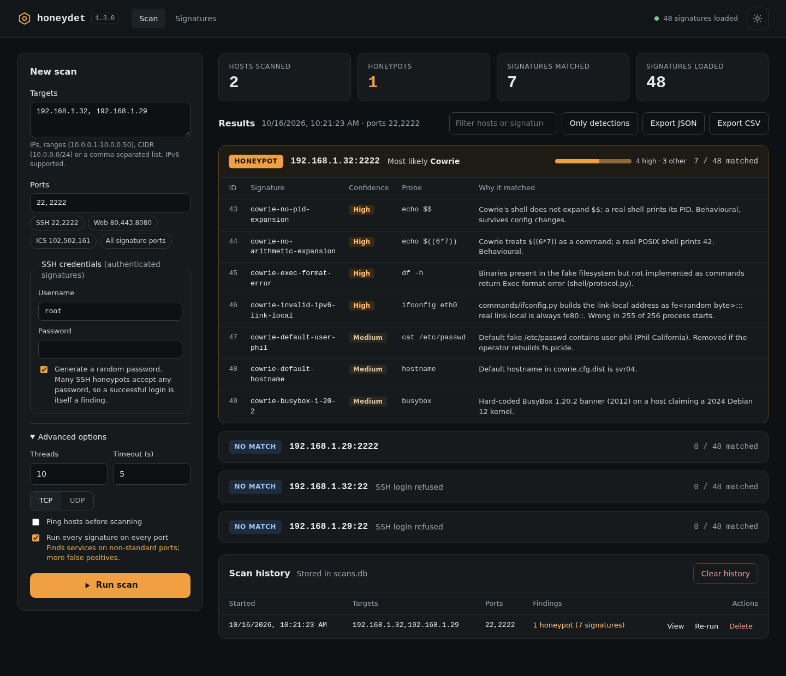
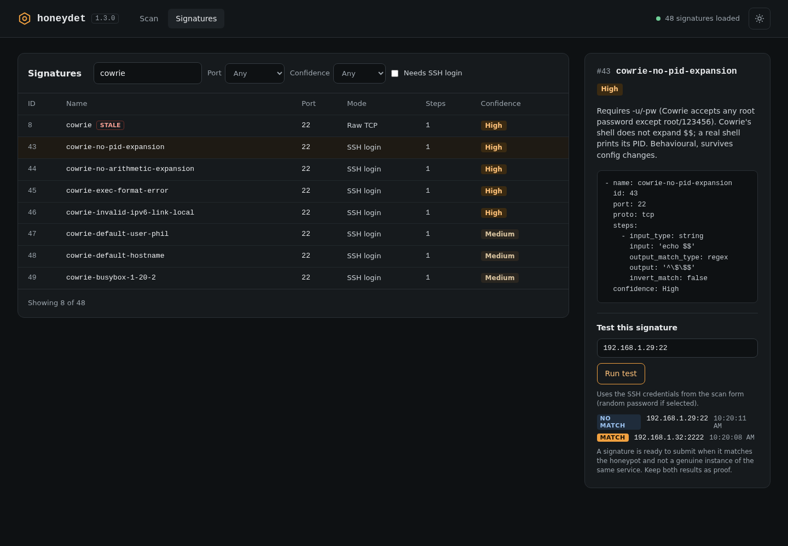
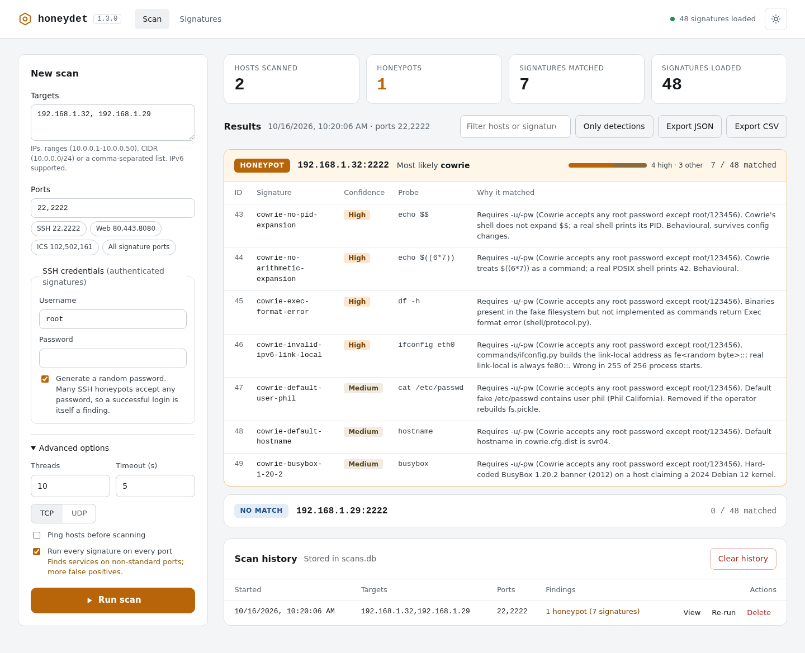

[](https://gist.github.com/cheerfulstoic/d107229326a01ff0f333a1d3476e068d)
[](https://github.com/dwyl/esta/issues)

[](https://hub.docker.com/r/referefrefref/honeydet)

# honeydet Go Honeypot Detector


### What does honeydet do?

honeydet is a signature based, multi-step, high interaction, multi-threaded honeypot detection tool written in Golang.
It can detect honeypots based upon the premise that, given a set of specifically crafted requests they will generate a unique and identifying response.
It can be run either as a web server, a command line tool, or as a web API.
Signatures support multi-step, hex, string and regex detection on TCP and UDP.
Features a SQL backend for persistent scans which can be managed through the web interface.
Shodan API integration for non-private IPs, automatically adds shodan host information when the flag is set (currently CLI only)

### What's new in 1.4.1
- Responses that arrive in more than one packet are now read in full.
- New Dionaea signatures (ids 50-57).

### What's new in 1.4.0
- **New web interface.** A self-contained page (no external libraries or CDNs) built into the binary, so it now works from release downloads.
- Results grouped per host, with the most likely honeypot family, a confidence breakdown, and the probe and reason for each matched signature.
- SSH credentials entered in the web form now reach the scan engine, with an option to generate a random password.
- Signature library: search, filters, YAML view and a per-signature test against a host (new `/signatures` and `/testSignature` endpoints).
- Scan history with view, re-run and delete; JSON and CSV export; light and dark themes; works at phone width.
- Ports where the SSH login is refused are reported as "SSH login refused" instead of being dropped from the results.

### What's new in 1.3.0
- **No more false positives from errors.** SSH, SNMP and Modbus steps that errored (including any command that exited non-zero, such as "command not found") were treated as matches. Against a genuine OpenSSH server the previous build reported 37 honeypot types; it now reports none.
- **Reliable SSH command signatures.** Commands run over a raw session channel with a fresh connection per signature, so output is captured from servers such as Cowrie that close the channel before acknowledging the exec request.
- **`invert_match` defaults to `false`** when omitted, rather than silently skipping the check.
- **SNMP and Modbus signatures only run on 161 and 502**, and the generic SNMP signature now checks for a non-numeric sysUpTime.
- **New Cowrie 3.x signatures** (ids 43-49). Id 8 no longer matches Cowrie 3.1.3.
- **Pure-Go SQLite** (modernc.org/sqlite): every release binary now has a working scan database, with no CGO required.
- **IPv6 targets** now work (host:port addresses were built with "%s:%d").
- Built with Go 1.26 and all dependencies updated to current releases (golang.org/x/crypto 0.58.0, gosnmp 1.45, modbus 1.6.4, go.yaml.in/yaml/v3 replacing the deprecated gopkg.in/yaml.v2). Requires Go 1.26+ to build.

### Signatures
The signature list is growing as I run through different methods of fuzzing, reverse engineering and comparing real protocols and servers to their emulated counterparts. I continue to add features to the signature format as required, and will extend the applications support of protocols using additional libraries as needed for things like DICOM and Modbus.

### Web Interface Features
- Run `honeydet -webserver` and browse to http://localhost:8888/ (the interface is built into the binary)
- Multi-threaded scans of single hosts, ranges, CIDR blocks and lists, across single ports, ranges or lists, with presets for common services
- SSH credentials for authenticated signatures, with an option to generate a random password
- Results grouped per host, showing the most likely honeypot, a confidence breakdown, and the probe and reason for each matched signature
- Signature library with search, filters, the YAML for each signature, and a test against any host
- Scan history with view, re-run and delete; JSON and CSV export; light and dark themes; works on mobile

### Wish-list/To-do
* ~~Docker image and docker-compose file for simple installation~~
* SSL
* JA4+, HASSH, and other fingerprinting support
* Add shodan flag to frontend
* PDF Reports
* Active port detection (without requiring root), and passive port detection using Shodan API in place of specific ports or ranges

### Web Interface
Scan results: Cowrie detected by its authenticated SSH signatures, with genuine servers reported as login refused.



Signature library: each signature's definition, tested against a honeypot (match) and a genuine server (no match).



Light theme:



### Installation

#### Download a release
Pre-built binaries for Linux, macOS and Windows (amd64, arm64, 386) are on the [releases page](https://github.com/referefref/honeydet/releases).

#### Build from source
Requires Go 1.26 or later. No C compiler is needed.
```bash
git clone https://github.com/referefref/honeydet.git
cd honeydet
go build
```

#### Use docker compose
```bash
# Note that scans.db will persist in the docker-compose file directory, if you need to map this somewhere else, edit the docker compose file
git clone https://github.com/referefref/honeydet.git
cd honeydet
docker compose up
```

### Command line options
```
  -H string
    	Short form of -hostfile
  -P string
    	Short form of -proto (default "tcp")
  -T int
    	Short form of -timeout (default 5)
  -b	Short form of -bypassPortCheck
  -bypassPortCheck
    	Bypass port match checking and run all signatures against all ports
  -c	Short form of -checkPing
  -checkPing
    	Check if the host responds to ping before scanning
  -d int
    	Short form of -delay
  -debug
    	Enable extra verbose (debug) output
  -delay int
    	Delay in milliseconds between requests to a single host
  -h string
    	Short form of -host
  -host string
    	Single host or range of hosts to scan (i.e. 1.1.1.1, 10.1.1.1/24, 1.2.37.10.20-1.2.37.10.30)
  -hostfile string
    	File containing a list of hosts to scan
  -o string
    	Short form of -output
  -output string
    	Output file for the report (default is stdout)
  -p string
    	Short form of -port (default "22")
  -password string
    	Password for authentication
  -port string
    	Target port(s) to scan, single (22), range (22-80), or list (22,80,443) (default "22")
  -proto string
    	Protocol (tcp or udp) (default "tcp")
  -pw string
    	Short form of -password
  -r string
    	Short form of -report (default "none")
  -report string
    	Type of report to generate (none, json, csv) (default "none")
  -s string
    	Short form of -signatures (default "signatures.yaml")
  -shodan
    	Enable Shodan API enrichment
  -signatures string
    	File with signatures (default "signatures.yaml")
  -t int
    	Short form of -threads (default 1)
  -threads int
    	Number of concurrent threads (default 1)
  -timeout int
    	Connection timeout in seconds (default 5)
  -u string
    	Short form of -username
  -username string
    	Username for authentication
  -v	Short form of -verbose
  -verbose
    	Enable verbose output
  -vv
    	Enable extra verbose (debug) output
  -w	Short form of -webserver
  -webserver
    	Run as a web server on port 8888
```
### Examples
* Scan a single host on port 2822 in verbose mode:
```
./honeydet -host 192.168.1.1 -port 2822 -verbose
```
* Scan a range of hosts in debug (extra verbose) mode:
```
./honeydet -host 192.168.1.1-192.168.1.30 -vv
```
* Scan hosts from a file with 100 threads checking for a ping before scanning, with a 5 second timeout, append shodan API information, and create a json report as report.json
```
./honeydet -hostfile hosts.txt -t 100 -T 5 -c -r json -o report.json -shodan
```
* Run in verbose webserver mode to expose an API endpoint:
```
./honeydet -webserver -verbose
curl 'http://localhost:8888/scan?host=10.1.1.1/24&report=json&port=3389'
```

## How to write a signature
Any contibutions to the signatures and detection logic are welcomed and will be integrated with proof, just submit the yaml as a PR.
Unique signature id's will be allocated upon collation of submitted signatures. If there's enough interest, i'll add author and reference url fields to the signature.

Add a new section to signatures.yaml or create a new signature yaml file with the following format
```yaml
signatures:
  - name: "signature name"
    id: 1337
    port: 22
    proto: tcp
    steps:
      - input_type: string
        input: "input string or hex value"
        output_match_type: regex
        output: "output match string, hex value or regex expression"
        invert_match: false
      - input_type: string
        input: "second step input"
        output_match_type: string
        output: "output match string for step 2"
        invert_match: false
    confidence: "High"
    comment: "Comment explaining the signature and its detection mechanism"
```

**Fields**
- `input_type`: `string` (a newline is appended) or `hex` (raw bytes). `GET`/`POST` send a request for `/`.
- `output_match_type`: `string` (contains), `hex` (hex of the response contains), `regex` (Go RE2 syntax, matched against the trimmed response), `no-response` or `not-equals`.
- `invert_match`: optional, defaults to `false`. Set `true` to match when the pattern is absent.
- All steps must match for the signature to match. Quote values containing `: ` or a leading special character, otherwise the YAML will not parse and no signatures load.

**Authenticated SSH signatures**

When `-username` and `-password` are supplied and the port presents an SSH banner, each step's `input` is run as a command over an authenticated SSH session, and the output (stdout and stderr) is matched. Each signature gets a fresh connection. Example from the Cowrie set:
```yaml
  - name: cowrie-no-pid-expansion
    id: 43
    port: 22
    proto: tcp
    steps:
      - input_type: string
        input: "echo $$"
        output_match_type: regex
        output: '^\$\$$'
        invert_match: false
    confidence: High
    comment: "Cowrie's shell does not expand $$; a real shell prints its PID."
```
Many SSH honeypots accept any password, so `-u root -pw <random>` is itself a useful test: a genuine server rejects it. Without credentials, steps are sent over a raw TCP connection.

**SNMP and Modbus**

Port 161 steps are sent as SNMP GET requests (the `input` is an OID) and port 502 steps as Modbus requests. Signatures for these ports only run on them, even with `-bypassPortCheck`.

**Testing a signature**

Before submitting, run it against the honeypot (it should match) and against a genuine instance of the same service (it should not), and include both outputs as proof with the PR.
